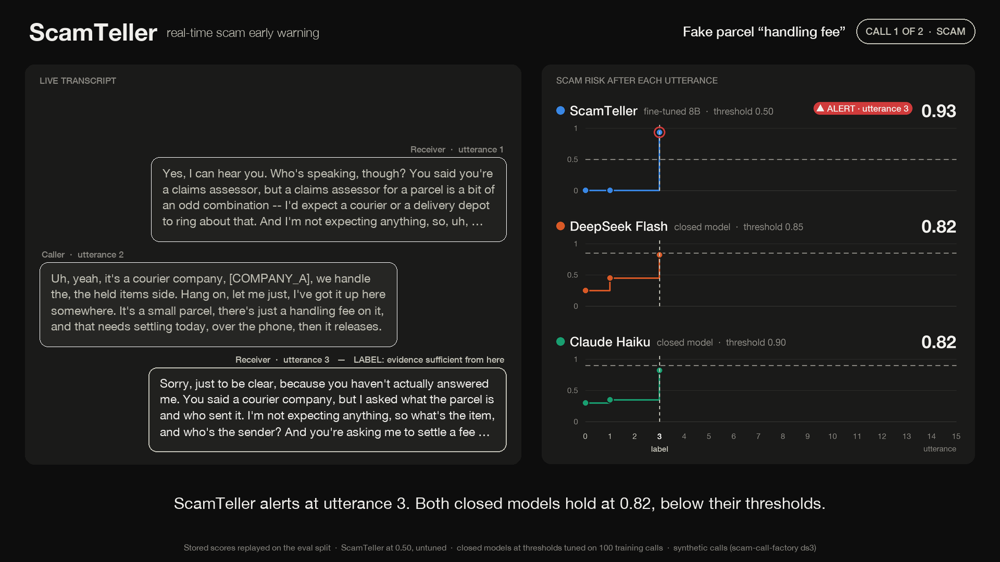
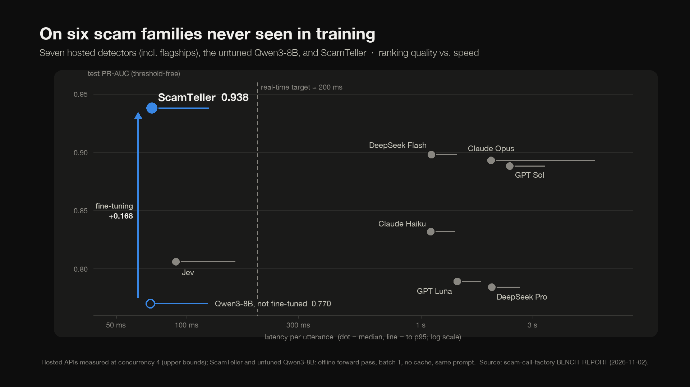

# ScamTeller

**Real-time phone-scam early warning: a fine-tuned Qwen3-8B that scores the call after every
utterance, in about 70 ms.**

Telling someone a call was a scam *after* they have read out their one-time passcode is worth
nothing. ScamTeller is built to answer a different question: not "is this a scam?" but "how
early can you tell?" It reads the transcript so far, after every utterance, and raises an alert
at the first moment a careful listener would have reasonable grounds to stop cooperating, while
staying quiet on legitimate calls that only *sound* alarming (a real bank fraud team, a real
arrears notice).

▶ **[Watch the 2-minute demo](demo/ScamTeller_demo_2min.mp4)**



---

## Results

On **six scam families never seen in training** (104 calls, 817 decision points), against
seven hosted detectors including flagship models:



| system | threshold | PR-AUC | detection | hard-neg false alarms | plain false alarms | pair acc. | median latency |
|---|---|---|---|---|---|---|---|
| **ScamTeller** (Qwen3-8B + LoRA) | 0.50, untuned | **0.938** | 0.864 | 0.029 | 0.000 | 0.55 | **71 ms** |
| Qwen3-8B, not fine-tuned (same prompt) | 0.50, untuned | 0.770 | 0.909 | 0.514 | 0.235 | 0.48 | 70 ms |
| DeepSeek Flash | 0.85 | 0.898 | 0.977 | 0.000 | 0.118 | 0.55 | 1,109 ms |
| Claude Opus | 0.85 | 0.893 | 1.000 | 0.000 | 0.000 | 0.34 | 1,995 ms |
| GPT Sol | 0.95 | 0.888 | 0.932 | 0.000 | 0.000 | 0.36 | 2,396 ms |
| Claude Haiku | 0.90 | 0.832 | 0.977 | 0.171 | 0.000 | 0.59 | 1,102 ms |
| Jev | 0.95 | 0.806 | 0.795 | 0.143 | 0.118 | 0.34 | 90 ms |
| GPT Luna | 0.95 | 0.789 | 1.000 | 0.057 | 0.176 | 0.41 | 1,429 ms |
| DeepSeek Pro | 0.95 | 0.784 | 0.636 | 0.057 | 0.059 | 0.30 | 2,006 ms |

- **PR-AUC** ranks every decision point by score and needs no threshold, so it is the fairest
  single comparison. ScamTeller ranks highest; fine-tuning adds +0.168 over the same base model
  with the same prompt.
- **Detection** is call-level: the share of scam calls (with a labelled detection point) on
  which the system alerts. At its untuned 0.50, ScamTeller trades recall for few false alarms
  (1 of 52 legitimate calls). Tuned on train like the hosted detectors, it would pick 0.30
  and catch 93%, but those tuning calls are in its own training data, so we report 0.50.
- **Pair accuracy**: the share of calls where the system separates the prefix just before the
  labelled detection point from the one at it. Threshold tuning cannot buy this.
- **Thresholds**: every hosted detector's threshold was tuned once on the same 100 training
  calls (maximise detection subject to hard-negative false alarms ≤ 10%), then applied
  unchanged to eval and to test.
- **Latency**: ScamTeller and the base model are timed offline, batch 1, no cache; hosted APIs
  were measured at concurrency 4, so their numbers are indicative upper bounds.

- **What is in this repository.** The seven hosted rows above are recomputable from
  `datasets/bench/` with no GPU, no keys and no spend. **ScamTeller's and the base model's
  *test* predictions are not committed yet** — they were produced on a separate GPU host, so
  those two rows are quoted, not reproducible here. Their **eval** run files *are* committed,
  and on eval the same comparison is stronger: PR-AUC 0.971 vs 0.826, pair accuracy 0.63 vs
  0.44, and hard-negative false alarms 0.000 vs 0.342. See
  [docs/BENCH_REPORT.md](docs/BENCH_REPORT.md) Table E and §12.

The full benchmark — eval and test, the tuning curves, latency and cost, and where the
remaining false positives are — is in [docs/BENCH_REPORT.md](docs/BENCH_REPORT.md).

## How it works

1. **Label moments, not calls.** Every call is synthetic. For a call of *N* utterances, an
   annotator model sees `utterances[:k+1]` and nothing else, and judges whether the evidence so
   far is sufficient. The first prefix where it is becomes the call's detection point; the
   per-prefix target `evidence_established` is false before it and true from it on.
2. **Make negatives hard.** About a third of the corpus is legitimate calls, many designed to
   look like scams, so a detector cannot win by alarming on anything that mentions money.
3. **Fine-tune on those moments.** Qwen3-8B with a LoRA adapter (1 epoch) learns to answer
   `A` (scam) or `B` for each decision point given a rubric prompt and the transcript so far.
   The risk score is P(A) / (P(A) + P(B)) at the first output token: one forward pass, nothing
   generated.

## The data

Release `ds3-rubric-v3-detect07`: 1,000 synthetic English calls across 57 scenario families
(scams, hard negatives and ordinary calls), with personal details replaced by placeholders.

| split | calls | decision points | positive | families |
|---|---|---|---|---|
| [train](datasets/train/ds3-rubric-v3-detect07/) | 777 | 5,933 | 1,119 | 50 |
| [eval](datasets/eval/ds3-rubric-v3-detect07/) | 119 | 912 | 149 | 51 (seen in train, plus one held-out) |
| [test](datasets/test/ds3-rubric-v3-detect07/) | 104 | 817 | 145 | 6, **disjoint from train** |

A *decision point* is a labelled prefix: the opening utterance and every receiver turn. How the
calls were generated, labelled, validated and split is documented in
[docs/EVAL_SYSTEM.md](docs/EVAL_SYSTEM.md) and [docs/REQUIREMENTS.md](docs/REQUIREMENTS.md).

## Repository layout

```
scamteller/        the model: data building, LoRA training, scoring, latency
configs/           training hyperparameters
callfactory/       the data factory and benchmark: call generation, prefix labelling,
                   splitting, hosted-detector adapters, threshold tuning, scoring tables
datasets/          the release (train / eval / test), scenario banks, and the raw
                   per-decision-point predictions of every benchmarked system (bench/)
docs/              benchmark report, evaluation-system design, requirements
demo/              the demo video, its renderer, and an offline replay player
tests/             tests for callfactory (no network, no keys)
```

## Reproduce

**Every table, with no GPU and no API keys.** The raw scores of every system are in
`datasets/bench/`, and scoring is deterministic:

```bash
python -m venv .venv && . .venv/bin/activate
pip install -e ".[dev]"
python -m callfactory bench-table datasets/test/ds3-rubric-v3-detect07 \
    --runs datasets/bench/ds3-test-c2 --thresholds datasets/bench/tune-c2/_thresholds.json
pytest -q
```

**Model weights are not released.** No adapter, no merged model and no checkpoint is in
this repository or in its releases, and `.gitignore` is set up to keep it that way. Reproducing
ScamTeller means training it; the recipe below is the one that produced the reported numbers.

**Train and score the model** (one or more 24 GB+ GPUs):

```bash
pip install -e ".[train]"
for s in train eval; do
  python -m scamteller.data datasets/$s/ds3-rubric-v3-detect07 --out data/$s.jsonl
done
torchrun --nproc_per_node 8 -m scamteller.train --config configs/qwen3_8b_prefix_ift.json \
    --train data/train.jsonl --val data/eval.jsonl --out runs/scamteller --merge
python -m scamteller.score --model runs/scamteller/merged \
    --split datasets/test/ds3-rubric-v3-detect07 --out runs/test/scamteller.jsonl
python -m scamteller.latency --model runs/scamteller/merged \
    --split datasets/test/ds3-rubric-v3-detect07
```

**Benchmark a hosted detector** (needs that provider's API key in `.env`, see `.env.example`):
see [docs/BENCH_REPORT.md §11](docs/BENCH_REPORT.md).

## Limitations

- **Synthetic calls, model-annotated labels.** Every call and every label was produced by LLMs
  and passed programmatic validation; the scenario families were reviewed by people, the
  per-prefix labels were not. Human labelling is in progress; until then, read the numbers as
  relative, not absolute.
- **Late reveals are the main miss.** Five of ScamTeller's six missed test scams show their
  decisive evidence only in the final utterance.
- **Six test families is a small sample** of "unseen". The ranking of the closer systems
  (ScamTeller, DeepSeek Flash, Claude Opus, GPT Sol) could change on a different set.
- **English only**, and phone channel only.
- **Latency is offline.** A production deployment would stream with prefix caching, which
  should be faster than batch-1 full re-encoding, but has not been benchmarked here.

## Credits

The prefix-level fine-tuning recipe was first run by a collaborator on the VERA project; the
code here is an independent re-implementation of it. Base model:
[Qwen3-8B](https://huggingface.co/Qwen/Qwen3-8B) (Apache-2.0).

## Intended use, and what this data is not for

This dataset exists so that **detectors** can be trained and measured. Every call in it is
synthetic, written to contain the observable warning signs a careful listener could act on, with
all proper nouns and identifying numbers replaced by placeholders (`[PERSON_1]`, `[COMPANY_A]`,
`[ACCOUNT_REF]`). It contains no real person, no real organisation, no real account and no
transcript of a real call.

**Please do not** use it as source material for generating scam scripts, for making calls to
anyone, or as a persuasion-technique corpus. Nothing in it is a working script: the transcripts
are deliberately built around *detectable* pretexts and stop short of actionable credential-theft
or payment steps, and they are released in the hope that detectors get better faster than the
calls do.

Two limits on what the numbers can support. The labels are **model-annotated and not yet
validated against human judgement** (see Limitations and `docs/EVAL_SYSTEM.md` §7), so nothing
here should be used to certify a deployed detector or to make a claim about a real call. And
because the calls are English-language and phone-channel only, a system that does well here has
not been shown to do well anywhere else.

## License

[Apache-2.0](LICENSE). The synthetic dataset is released under the same license.
